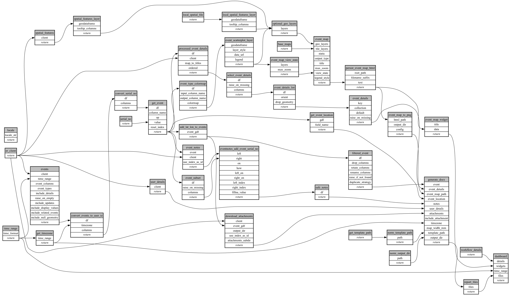

```
# AUTOGENERATED BY ECOSCOPE-WORKFLOWS; see fingerprint in README.md for details

```

```yaml
# fingerprint:
artifacts_sha256_basic: 6030f928df1c4ce2ef228af63d6752aa10756108785909255a87f7f2295f85e1
artifacts_sha256_strict: 0d0e6dc7399821edb310bae8fae8338a477d45ac13ca7bc7fa0799c1c5315931
installed_requirements:
- channel: https://repo.prefix.dev/ecoscope-workflows/
  name: ecoscope-platform
  version: {version: ==2.28.0}
- channel: https://repo.prefix.dev/ecoscope-workflows-custom/
  name: ecoscope-workflows-ext-custom
  version: {version: ==0.1.6}
- channel: conda-forge
  name: pydeck
  version: {version: ==0.9.2}
- channel: https://repo.prefix.dev/ecoscope-workflows-custom/
  name: ecoscope-workflows-ext-apn
  version: {version: ==0.0.33}
params_sha256: 2e173eb38ed4521c56112af0185944c9e0d43f3e633b2cbf1c44d3692775f773
spec_sha256: 28a6e2b7ff76e4c6b0df7a074c6ae9fc11f38e6f1aabe7937b42bbcdd007d577

```

# ecoscope-workflows-individual-event-workflow


